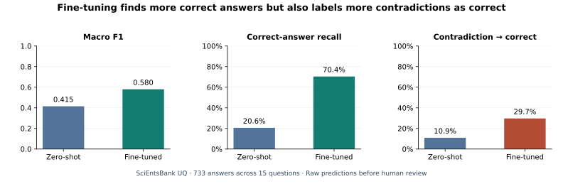

# Science Answer Benchmark

**Can a model tell a correct science answer from one that uses the right words but gives the wrong explanation?**

Teaching mathematics and science made me notice how often two answers use the same vocabulary but express different reasoning. I built this benchmark to see when a classifier can distinguish those answers, where it fails, and whether its predictions justify automated acceptance.

**4,969 training-set answers audited · 15 unseen questions · 733 held-out answers evaluated**

[Explore the data](reports/analysis_report.md) · [Inspect the pipeline](reports/engineering/README.md) · [Review the model](reports/nli/README.md)

## The result: better recall, more contradictions labeled correct

On the official SciEntsBank **Unseen Questions** split, fine-tuning helped MiniLM recognize more valid answers. It also made the model more likely to classify a contradiction as correct.



| Official UQ metric | Zero-shot MiniLM | Fine-tuned MiniLM |
|---|---:|---:|
| Macro F1 (three classes) | 0.415 | **0.580** |
| Correct answers recognized | 62/301 (20.6%) | **212/301 (70.4%)** |
| Contradictory answers labeled correct ↓ | **7/64 (10.9%)** | 19/64 (29.7%) |

**One answer that changed the decision.** For a question about why bulbs are dimmer in a series circuit, a student attributed the dimness to one bulb taking all the electricity. The zero-shot model flagged the contradiction; the fine-tuned model called the answer correct. [See this case and an example that improved](reports/nli/README.md#from-development-to-held-out-evaluation).

**Decision: keep human review.** None of the 159 thresholds tested on separate calibration data met the preset requirements for precision, contradiction risk, and minimum coverage. The resulting policy routed all 733 UQ answers to human review. The table shows raw model predictions; those errors still matter.

## From raw answers to a review decision

| Stage | What I studied or built | Where to see it |
|---|---|---|
| **Data analysis** | Audited label imbalance, domain differences, answer length, reference overlap, duplicate inputs, and conflicting annotations. | [14 EDA figures and tables](reports/analysis_report.md) · [7 statistical figures](reports/advanced/README.md) |
| **Data engineering** | Built a reproducible SQL pipeline and checked table totals, data contracts, lineage, and partition overlap. | [SQL pipeline and quality checks](reports/engineering/README.md) · [Data dictionary and source files](data/README.md) |
| **Data science** | Split by whole questions and compared classical models before fine-tuning MiniLM. Evaluated correct-answer recall and contradiction errors separately. | [Split diagnostics](reports/splits/README.md) · [Classical models](reports/models/README.md) · [Confusion matrices and calibration](reports/nli/README.md) |
| **AI engineering** | Recorded checkpoint identity, paired predictions, and the human review decision; packaged evaluation and chart generation for reuse. | [Evaluation notebook](notebooks/05_unseen_question_evaluation.ipynb) · [Prediction CSV](reports/nli/uq_paired_predictions.csv) · [Figure code](scripts/build_nli_portfolio.py) |

## Two data findings behind the evaluation

- **The labels are uneven.** Correct answers make up **40.41%** of the 4,969 training-set records; just **0.46%** are non-domain responses. The exploratory analysis keeps five source labels; the MiniLM experiment maps them to three NLI classes.
- **The unit of generalization is the question.** A number of answers can come from the same question, and the audit found six groups of identical normalized inputs with conflicting labels. The UQ audit verified zero question-ID or normalized-input overlap with the fit, development, and calibration partitions. Its 733 answers span only 15 questions.


[Audit notebook](notebooks/00_dataset_audit.ipynb) · [EDA notebook](notebooks/01_exploratory_analysis.ipynb) · [Statistical notebook](notebooks/01b_statistical_analysis.ipynb) · [Split notebook](notebooks/02_split_design.ipynb) · [SQL notebook](notebooks/02b_data_pipeline.ipynb)

## Reproduce

From this project directory, with Python 3.12:

```bash
python -m pip install -r requirements.txt
python scripts/build_analysis.py
python scripts/build_splits.py
python scripts/verify_release.py
python -m unittest discover -s tests -v
```

To regenerate and execute the original notebooks:

```bash
python scripts/prepare_notebooks.py
python scripts/prepare_split_notebook.py
# If a network-based Jupyter kernel is unavailable:
python scripts/prepare_notebooks.py --in-process
```

To rebuild the advanced analysis, local SQL warehouse, and two extension notebooks in one command:

```bash
python scripts/run_pipeline.py --stage advanced
```

Use `--stage full` to also rebuild the original source audit and v1 split. Intentional artifact changes require review before `--refresh-checksums`; ordinary validation does not accept changed hashes automatically. The warehouse binary is rebuilt locally rather than committed. A GitHub Actions workflow runs the advanced build and validation on pushes and pull requests.

The audit and EDA notebooks were executed with IPython in-process execution. The split, statistical-analysis, and SQL notebooks were executed sequentially with Python and captured stdout/raw-MIME displays. All outputs are computed.

The bundled source subset allows offline data analysis after dependencies are installed. The original data notebooks locate the project automatically and clone this public repository if needed. The model notebook requires the updated checkout in the runtime. The pipeline preserves source text and labels, exports all official partitions, validates expected sizes, and rebuilds CSV tables plus PNG figures. [Provenance](data/provenance.json) and [checksums](checksums.sha256) record exactly which data and files were used.

## Interpretation limits and next work

The benchmark measures agreement with historical corpus annotations. It does not measure educational outcomes or teacher time savings. Rare labels and small numbers of evaluation questions or domains limit generalization.

Future experiments can use development errors to test whether contradiction-focused training reduces false positives while retaining correct-answer recall. The existing UQ result is a fixed reference.

## Sources and license

Dataset: Dzikovska et al. (2013), *SemEval-2013 Task 7: The Joint Student Response Analysis and 8th Recognizing Textual Entailment Challenge*. [Paper](https://aclanthology.org/S13-2045/) · [Author-hosted dataset](https://github.com/myrosia/semeval-2013-task7).

Original data, transformed tables, and data-derived figures/reports are distributed under **CC BY-SA 3.0 Unported**. See [the full original license](DATA_LICENSE.txt) and [source attribution](SOURCE_README.md). Dataset authors do not endorse this project. Original analysis scripts in this subproject are MIT licensed; the [code license](LICENSE_CODE) does not replace the dataset license.
