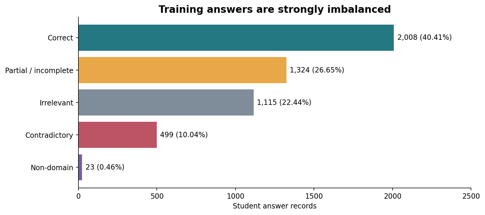
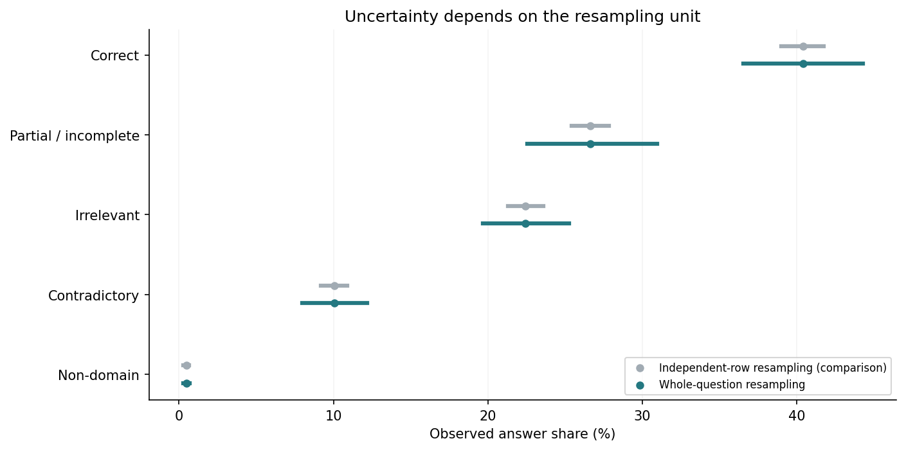
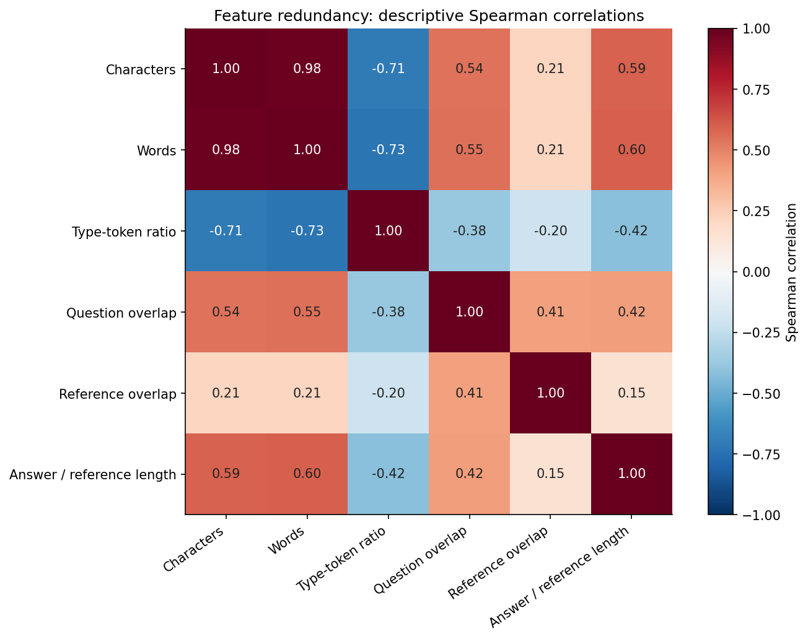
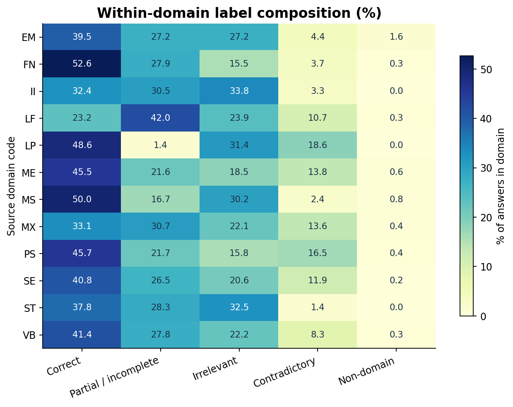
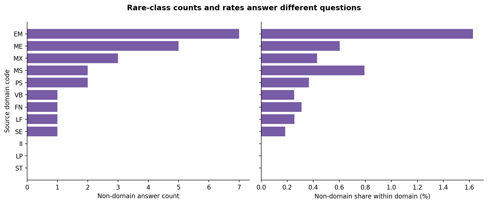
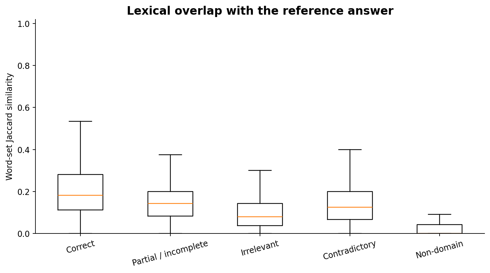
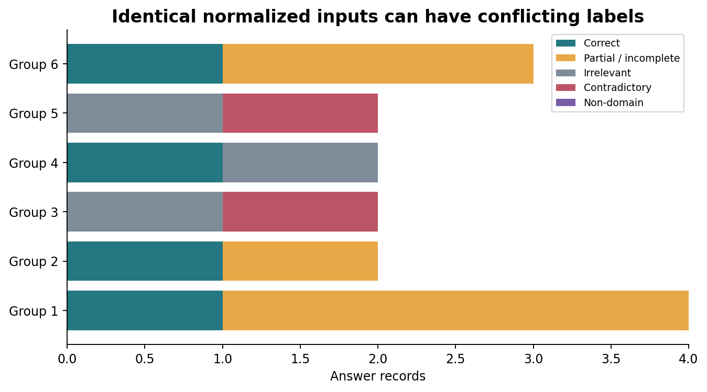
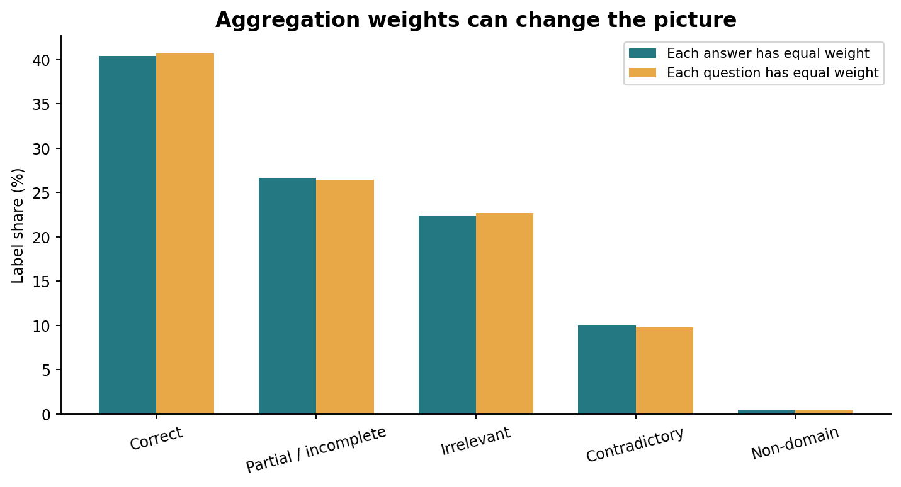

# Science Answer Benchmark — Data Analysis

**What can the data tell us before building a science short-answer classifier?**

An independent education-data portfolio project that investigates class imbalance, question and domain variation, answer language, repeated inputs, and conflicting annotations in SciEntsBank. My work in mathematics and science education motivates the question: what evidence is available in a short response, and what limitations should be understood before using an automated classifier?

**Current scope: data preparation, auditing, exploratory analysis, question-grouped development splitting, cluster-resampling statistics, and a validated SQL data pipeline.** Model training and application development are deferred. Every number and figure in this release is computed from the public source data; no prediction accuracy or learning-impact result is claimed.

## Three perspectives, backed by executable work

| Perspective | Work demonstrated | Evidence |
|---|---|---|
| Data Analyst | Group comparisons, explicit denominators, SQL reports, and clear findings | [Advanced visual report](reports/advanced/README.md) |
| Data Scientist | Question-cluster resampling, feature redundancy, vocabulary novelty, and annotation ambiguity | [Statistical notebook](notebooks/01b_statistical_analysis.ipynb) |
| Data Engineering | Data contracts, six relational tables, four SQL views, atomic rebuilds, lineage, and automated integrity checks | [Pipeline notebook](notebooks/02b_data_pipeline.ipynb) |

The repository now contains **five executed notebooks, 24 analytical/diagnostic figures, a 4,969-row feature table, and a reproducible local batch pipeline**. It does not claim production deployment or model performance.

## Start here

- [Executed dataset-audit notebook](notebooks/00_dataset_audit.ipynb)
- [Executed exploratory-analysis notebook — all 14 figures](notebooks/01_exploratory_analysis.ipynb)
- [Executed split-design notebook](notebooks/02_split_design.ipynb)
- [Executed statistical-analysis notebook](notebooks/01b_statistical_analysis.ipynb)
- [Executed data-contract and SQL notebook](notebooks/02b_data_pipeline.ipynb)
- [Statistical methods and feature definitions](docs/advanced_analysis.md)
- [Engineering architecture and rebuild instructions](docs/data_engineering.md)
- [Split protocol, duplicate policy, and final-fit caveats](docs/split_design.md)
- [Three split-diagnostic figures](reports/splits/README.md)
- [Visual report — all 14 exploratory figures with interpretation](reports/analysis_report.md)
- [Data files, dictionary, attribution, and license](data/README.md)
- [Analysis methods and limits](METHODS.md)
- [Machine-readable audit summary](reports/tables/audit_summary.json)

[Open the audit in Colab](https://colab.research.google.com/github/Junghwan0516/science-answer-benchmark/blob/main/notebooks/00_dataset_audit.ipynb) · [Open the EDA in Colab](https://colab.research.google.com/github/Junghwan0516/science-answer-benchmark/blob/main/notebooks/01_exploratory_analysis.ipynb)

## Development split ready; model training next

[Open split design in Colab](https://colab.research.google.com/github/Junghwan0516/science-answer-benchmark/blob/main/notebooks/02_split_design.ipynb)

| Internal partition | Whole questions | Answer records | Non-domain support |
|---|---:|---:|---:|
| Fit | 95 | 3,536 | 17 |
| Development | 20 | 715 | 3 |
| Calibration | 20 | 718 | 3 |

Assignments use only official training records. They have zero pairwise overlap in answer IDs, question IDs, and normalized complete inputs. The deterministic first-eligible allocation uses seed 42 and class-support/size constraints; no model score enters selection. Three rare-class records still provide very limited evidence. All rows and labels are retained; optional fit-only inverse-input weights are prepared for a future sensitivity experiment.

**The final-fit recipe is not yet frozen.** A classifier fitted only on the 95 fit questions would see only some official-UA questions. Before official test evaluation, document either full-training refit with cross-fitted calibration or the actual seen/held-out-question coverage of a retained split model. See the [full protocol](docs/split_design.md).

## Questions investigated

1. How imbalanced are the five answer labels?
2. How do domain and question composition change the distribution we observe?
3. What do answer length, reference overlap, and negation markers reveal, and what can they not establish?
4. How common are repeated complete inputs and conflicting labels?
5. Which data properties must inform a later question-grouped evaluation?

## Measured findings

| Finding | Result |
|---|---:|
| Official training answer records | 4,969 |
| Training questions / domain codes | 135 / 12 |
| Correct class | 2,008 records (40.41%) |
| Non-domain class | 23 records (0.46%) |
| Questions / domains with non-domain records | 19 / 9 |
| Median training answer length | 11 whitespace-separated words |
| Unique normalized complete training inputs | 4,826 |
| Repeated complete-input groups / excess rows | 82 / 143 |
| Label-conflicting input groups / records | 6 / 15 |
| UA records with a complete input also present in training | 25 / 540 |

Repeated records can be legitimate independent submissions. Conflicting annotations are flagged, not silently corrected. The official benchmark partitions and original labels are preserved. The 40.41% figure is a **training-data majority-class reference**, not a fitted model or test score.



## Added statistical and engineering findings

- The fit vocabulary contains **2,041 lexical word types**. **343 of 7,565 development token occurrences (4.53%)** are absent from it; calibration and official test vocabulary are excluded from this diagnostic.
- Exactly identical raw input triples form **4,827 groups**, including six label-conflicting groups. A deterministic predictor restricted to these inputs must disagree with at least six recorded training labels. This is an empirical label-consistency constraint, not model or test accuracy.
- **2,000 whole-question bootstrap replicates** expose the effect of the resampling unit. Within-domain interval plots disclose question counts and suppress intervals for domains with fewer than five questions.
- The warehouse contains **six constrained tables** and **four SQL views**. SQL answer/label/question totals reconcile with Pandas; **12 data-quality checks** and corruption/failure tests cover the pipeline.





See [all seven new figures](reports/advanced/README.md), [SQL outputs and lineage](reports/engineering/README.md), and the [feature table](data/processed/training_features.csv).

## Domain variation

Counts and percentages answer different questions. A domain with more responses can contribute more minority-class records without having the highest within-domain minority rate. The complete tables accompany every analysis.





## Text and annotation quality

Answer length and reference-word overlap are descriptive signals. Neither establishes scientific correctness. Duplicate checks compare the full normalized question/reference/response input, rather than response text alone.







See the [full visual report](reports/analysis_report.md) for all 14 figures, including domain counts, answer-length distributions, question sample sizes, label entropy, duplicates, negation markers, and domain overlap differences.

## Included data

| Partition | Answer records | Use in this release |
|---|---:|---|
| [Training CSV](data/processed/train.csv) | 4,969 | Audit and descriptive analysis |
| [Unseen Answers CSV](data/processed/test-unseen-answers.csv) | 540 | Export, inventory, and overlap audit |
| [Unseen Questions CSV](data/processed/test-unseen-questions.csv) | 733 | Export, inventory, and overlap audit |
| [Unseen Domains CSV](data/processed/test-unseen-domains.csv) | 4,562 | Export, inventory, and overlap audit |

Download the [selected original Core XML archive](data/raw/scientsbank_core.zip) to inspect the 331 source XML files. One record is one answer, not one unique learner. UA repeats the training questions, so question counts cannot be summed across partitions. The project contains 10,804 answer records and 196 unique questions in total.

## Reproduce

From this project directory, with Python 3.12:

```bash
python -m pip install -r requirements.txt
python scripts/build_analysis.py
python scripts/build_splits.py
python scripts/verify_release.py
python -m unittest discover -s tests -v
```

To regenerate and execute the original notebooks:

```bash
python scripts/prepare_notebooks.py
python scripts/prepare_split_notebook.py
# If a network-based Jupyter kernel is unavailable:
python scripts/prepare_notebooks.py --in-process
```

To rebuild the advanced analysis, local SQL warehouse, and two extension notebooks in one command:

```bash
python scripts/run_pipeline.py --stage advanced
```

Use `--stage full` to also rebuild the original source audit and v1 split. Intentional artifact changes require review before `--refresh-checksums`; ordinary validation does not accept changed hashes automatically. The warehouse binary is rebuilt locally rather than committed. A GitHub Actions workflow runs the advanced build and validation on pushes and pull requests.

The audit and EDA notebooks were executed with IPython in-process execution. The split, statistical-analysis, and SQL notebooks were executed sequentially with Python and captured stdout/raw-MIME displays. All outputs are computed.

The bundled source subset allows offline data analysis after dependencies are installed. Colab notebooks locate the project automatically and clone this public repository if needed. The pipeline preserves source text and labels, exports all official partitions, validates expected sizes, and rebuilds CSV tables plus PNG figures. [Provenance](data/provenance.json) and [checksums](checksums.sha256) record exactly which data and files were used.

## Interpretation limits and next work

This descriptive study does not measure automatic grading quality, student learning, or teacher time savings. Question-grouped development partitions are now available. Future model work still needs explicit class supports, duplicate-handling sensitivity analysis, a frozen final-fit/calibration recipe, and independently reported UA/UQ/UD results. The rare class and small numbers of evaluation questions/domains limit reliable generalization claims.

The next task is `03_classical_baselines.ipynb`: fit classical models using the versioned assignments, select settings on development only, and reserve calibration for probabilities. The duplicate/conflict policy is now documented; original rows and labels remain unchanged. No classifier has been fitted in this release.

## Sources and license

Dataset: Dzikovska et al. (2013), *SemEval-2013 Task 7: The Joint Student Response Analysis and 8th Recognizing Textual Entailment Challenge*. [Paper](https://aclanthology.org/S13-2045/) · [Author-hosted dataset](https://github.com/myrosia/semeval-2013-task7).

Original data, transformed tables, and data-derived figures/reports are distributed under **CC BY-SA 3.0 Unported**. See [the full original license](DATA_LICENSE.txt) and [source attribution](SOURCE_README.md). Dataset authors do not endorse this project. Original analysis scripts in this subproject are MIT licensed; the [code license](LICENSE_CODE) does not replace the dataset license.
