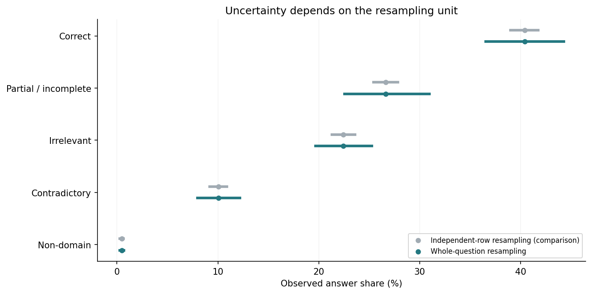
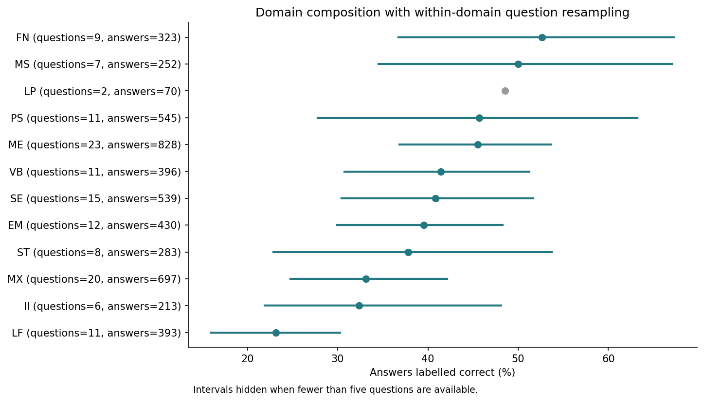
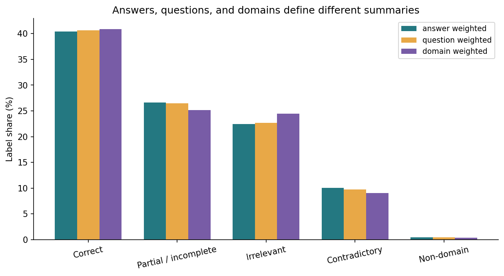
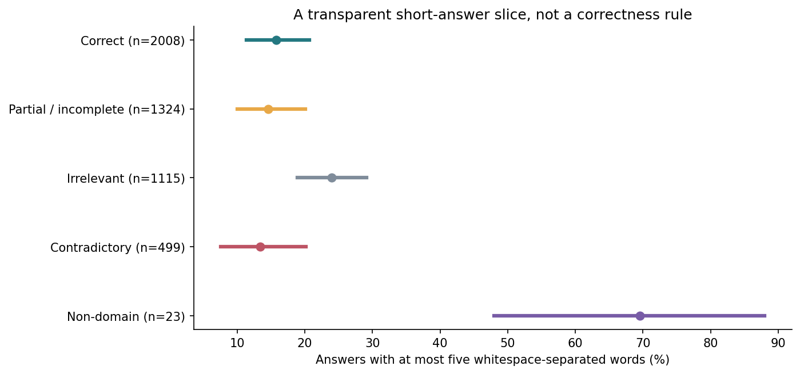
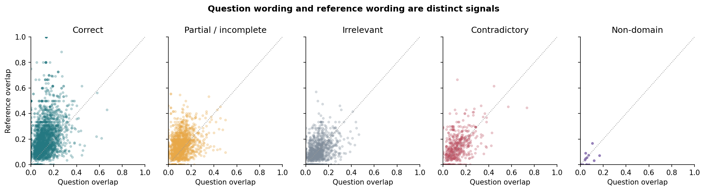
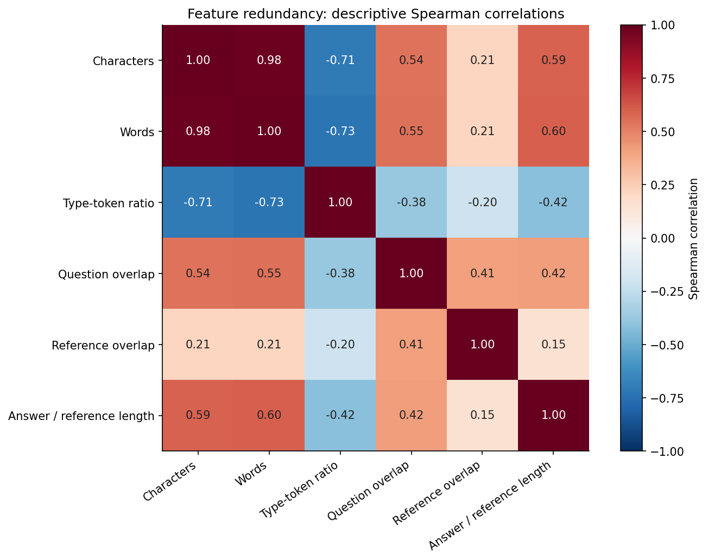
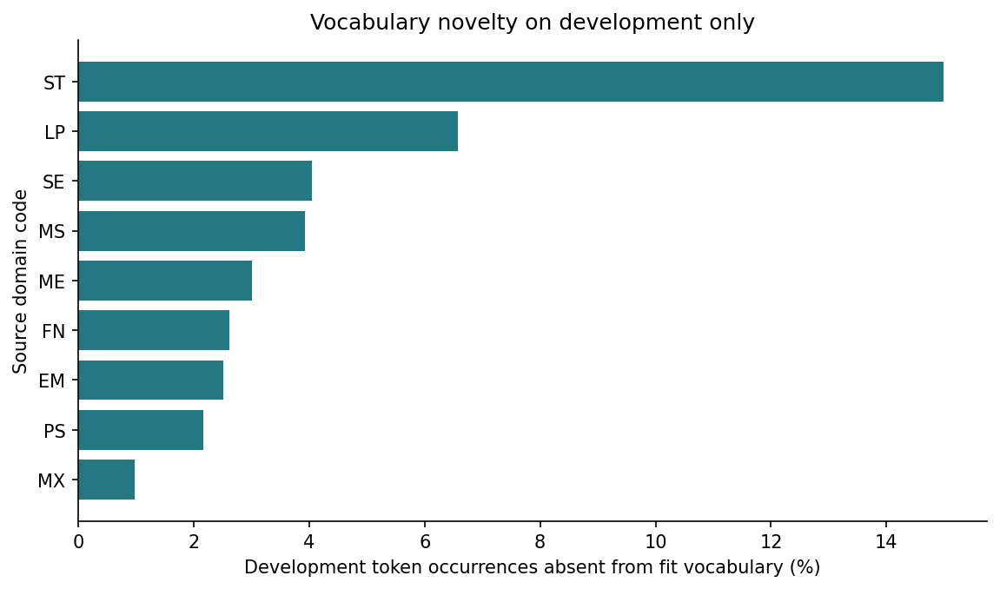

# Advanced Statistical Analysis

Seven additional views of the official training corpus. These are descriptive results; no prediction model is fitted. [Methods](../../docs/advanced_analysis.md) · [Executed notebook](../../notebooks/01b_statistical_analysis.ipynb) · [Supporting tables](tables/)

## Question-cluster resampling

Resample whole questions, preserving the dependence among their answers. The independent-row comparison uses multinomial class-count draws. Both use 2,000 replicates and empirical percentile bounds; these are resampling-stability summaries conditional on the observed corpus, not a guarantee for future learners.

## Domain composition and uncertainty

Each domain is resampled by its own questions. Intervals are hidden for domains with fewer than five questions. The observed correct share describes annotations; it is not an intrinsic difficulty or ability estimate.

## Three aggregation targets

Pooling answers, averaging question-level shares, and averaging domain-level shares define three different estimands. These are explicit weighting choices, not interchangeable estimates.

## Short-answer slice

The cutoff of at most five whitespace-separated words is exploratory. Within each label, contributing questions are resampled. Small class supports remain a limitation. Length is not a correctness rule.

## Question versus reference overlap

Word-set Jaccard overlap is calculated separately against question wording and reference wording. Points are descriptive observations, not a fitted classifier or a causal relationship.

## Feature engineering and redundancy

Spearman correlations summarize monotone associations among numeric features; class labels are not encoded as an ordinal numeric variable. Character count and word count are mechanically related. No independence-based p-values are reported.

## Fit-to-development vocabulary novelty

Build the vocabulary from fit answers only. Count development token occurrences absent from that vocabulary. The calibration partition and official test sets are excluded from this vocabulary analysis.

## Numeric findings

The correct-label share is 40.41%. Whole-question resampling gives a 2.5th–97.5th percentile range of approximately 36.54–44.27%, compared with 39.02–41.76% from independent-row resampling. These are empirical resampling summaries, not guaranteed future-population confidence intervals.

Fit contains 2,041 lexical types. Development contains 343 unseen token occurrences out of 7,565 (4.53%); calibration and official test vocabulary are excluded. Exactly identical raw inputs form 4,827 groups; six conflicting groups force at least six training-label disagreements for any deterministic predictor restricted to those inputs. This is not a model score.

Original source data and split assignments remain unchanged. Data-derived outputs: CC BY-SA 3.0, Dzikovska et al. (2013), https://aclanthology.org/S13-2045/.
