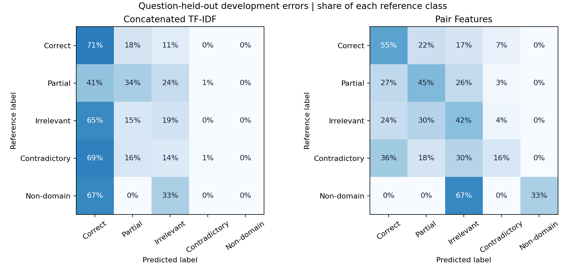
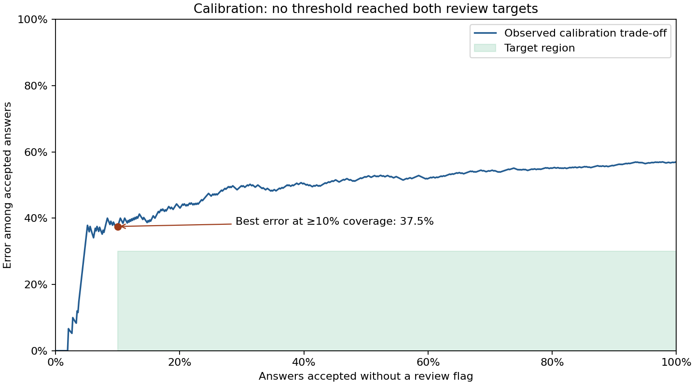

# Classical classifier and review policy

[Executed notebook](../../notebooks/03_classical_baselines.ipynb) · [Development metrics](development_metrics.csv) · [Official test results](official_metrics.csv) · [Frozen model card](model_card.json)

## Development result

The classifier using direct answer/reference comparison improved fixed-five-class macro F1 from **0.237 to 0.413** compared with concatenating the texts. Contradictory answers predicted as correct fell from **51 to 27 of 74**. Compared with the answer-only model, macro F1 increased from 0.330 and false-correct contradictions fell from 40. Adding LSA similarities did not improve either of those development measures. Only three development records are non-domain; macro F1 and per-class scores should be read with the support counts.



## Where the improvement comes from

On the same 74 contradictory records, contradiction recall rose from **1/74 to 12/74**, but **27/74** were still labelled correct. On genuine correct answers, recall fell from **222/314 to 172/314**. The model's broader coverage across labels comes with more errors on genuine correct answers. A paired resampling of the 20 development questions (4,000 replicates, fitted models held fixed) gave percentile ranges of **+0.041 to +0.297** for the macro-F1 difference and **−50.8 to −13.1 percentage points** for the false-correct rate difference, both compared with concatenation. This is sensitivity to question composition, not independent evidence after model selection.

[Five manually reviewed errors](ERROR_REVIEW.md) include opposite circuit states, an incorrect material condition, and a likely annotation inconsistency.

## Freeze and test

The selected classifier was retained on the 95 fit questions. Temperature scaling and the review threshold search used the 20 calibration questions; neither used the official test labels. The threshold rule maximizes calibration coverage under a **30% maximum accepted error** and **10% minimum coverage**. These are exploratory portfolio criteria. No threshold met both; the least accepted error at coverage of at least 10% was **37.5% (27/72)**. The policy therefore sends every answer to human review. With zero accepted examples, accepted error is undefined.



| Official split | Answers | Fixed-five macro F1 | Supported-label macro F1 | Fit-seen questions |
| --- | ---: | ---: | ---: | ---: |
| UA: Unseen Answers | 540 | 0.423 | 0.423 | 95 of 135 |
| UQ: Unseen Questions | 733 | 0.276 | 0.344 | 0 of 15 |
| UD: Unseen Domains | 4,562 | 0.513 | 0.513 | 0 of 46 |

The official names describe the original corpus split. In this retained split model, only 380 of the 540 UA answers belong to questions seen during fitting, so the result is not directly comparable with a full-training UA submission. UQ has no non-domain reference labels; the supported-only column makes the denominator explicit. Differences across UA/UQ/UD also reflect changes in question and label mix. Within UA, accuracy was **58.9%** for answers to fit-seen questions and **52.5%** for answers to questions absent from the fit partition. Nineteen UA records share a normalized question/reference/student-answer input with fit; excluding them leaves 521 answers, 57.2% accuracy, and 0.425 fixed-five macro F1. UQ and UD had no such matches. The official UA split and scores are kept unchanged.

## Reproduce

From the benchmark root with Python 3.12:

```sh
python -m pip install -r requirements-model.txt
python scripts/run_model_study.py development --work-dir .model-run
python scripts/run_model_study.py freeze --work-dir .model-run
python scripts/run_model_study.py evaluate --work-dir .model-run
python scripts/plot_review_policy.py .model-run/reports
python scripts/analyze_model_errors.py .model-run
python scripts/verify_model_run.py .model-run/reports
```

The freeze command reproduces development comparisons, fits the chosen model, and records hashes for the artifact, source code, and training inputs. Use a new work directory to reproduce a frozen run without overwriting it. Evaluation verifies those hashes before reading official test files. The binary artifact is generated locally and excluded from Git.
