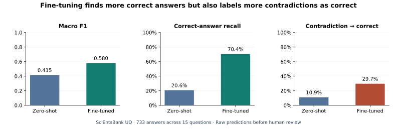
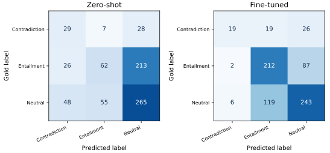
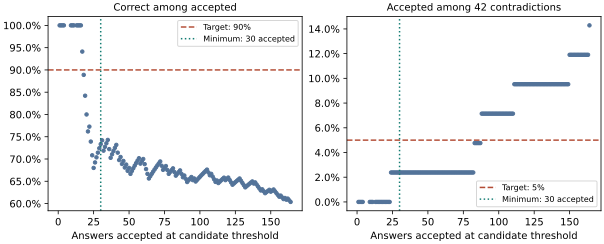

# MiniLM fine-tuning and evaluation on unseen science questions

A student can use the right vocabulary while reversing the scientific explanation. This experiment tests whether fine-tuning helps a classifier recognize valid answers and whether it reduces the separate error of calling a contradictory answer correct.

| Data partition | Questions | Answers | Purpose |
|---|---:|---:|---|
| Fit | 95 | 3,536 | Update MiniLM weights |
| Development | 20 | 715 | Select the checkpoint |
| Calibration | 20 | 718 | Check an automatic acceptance rule |
| Official Unseen Questions (UQ) | 15 | 733 | Evaluate both fixed models |

The UQ audit found no shared question IDs or normalized complete inputs with any internal partition. This is a three-class projection of the source labels: **correct → entailment**, **contradictory → contradiction**, and **partially correct/incomplete, irrelevant, and non-domain → neutral**. It is separate from the [classical model study](../models/README.md).

## From development to held-out evaluation

The zero-shot comparison uses the same base MiniLM, identical examples, and the same input format: question and reference answer paired with the student answer. The lowest training loss occurred at epoch 3, but epoch 1 was selected by development macro F1 (0.664 versus 0.643 and 0.648 in epochs 2 and 3).

| Split and metric | Zero-shot | Fine-tuned |
|---|---:|---:|
| Development macro F1 | 0.430 | 0.664 |
| Development contradictions labeled correct | 5/74 (6.8%) | 20/74 (27.0%) |
| UQ macro F1 | 0.415 | 0.580 |
| UQ correct recall | 62/301 (20.6%) | 212/301 (70.4%) |
| UQ contradictions labeled correct | 7/64 (10.9%) | 19/64 (29.7%) |

Of the 301 correct UQ answers, the fine-tuned model recovered 164 that the baseline missed and lost 14 that the baseline had found. Among the 64 contradictions, 15 answers newly became false positives, while 3 stopped being false positives. The model also predicted entailment on 119 neutral answers, up from 55. The gain in recall came with a broader tendency to predict entailment on this split.

| Question | Gold label | Zero-shot → Fine-tuned | What happened |
|---|---|---|---|
| `EM_33b` | Entailment | Neutral → Entailment | The student explained that the harder paperclip can scratch a mineral already scratched by a softer tool. |
| `ME_36` | Contradiction | Contradiction → Entailment | The student attributed dim series bulbs to one bulb taking all the electricity, conflicting with the reference explanation. |

## Review policy

On the separate calibration split, none of 159 candidate thresholds met all three criteria: at least 30 accepted answers, at least 90% precision among accepted answers, and at most 5% of reference-labeled contradictions accepted. The policy was fixed before UQ evaluation and routed all 733 UQ answers to human review. With zero automated accepts, precision for automated acceptance is undefined. The policy does not erase the raw model errors.

## Inspect and reproduce

- [UQ notebook](../../notebooks/05_unseen_question_evaluation.ipynb) — requires the saved fine-tuned checkpoint, including model and tokenizer files.
- [Aggregate UQ report](uq_report.json) · [733 paired predictions](uq_paired_predictions.csv) · [159 calibration candidates](calibration_thresholds.csv). Use the sample IDs to look up text in the [source UQ table](../../data/processed/test-unseen-questions.csv).
- [Figure source](../../scripts/build_nli_portfolio.py) — run `python scripts/build_nli_portfolio.py` from the repository root after installing the project requirements.
- [Data dictionary, attribution, and license](../../data/README.md) · [Exploratory figures and tables](../analysis_report.md) · [SQL and data checks](../engineering/README.md).

This is an evaluation on 15 held-out English science questions. The 733 answers are clustered by question, and these results do not establish performance on other subjects or in classrooms.
