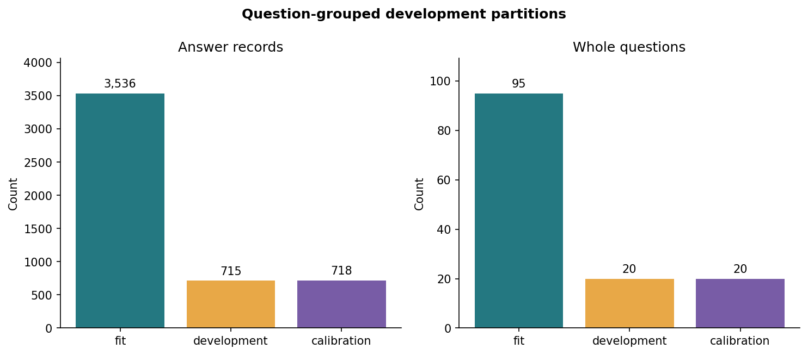
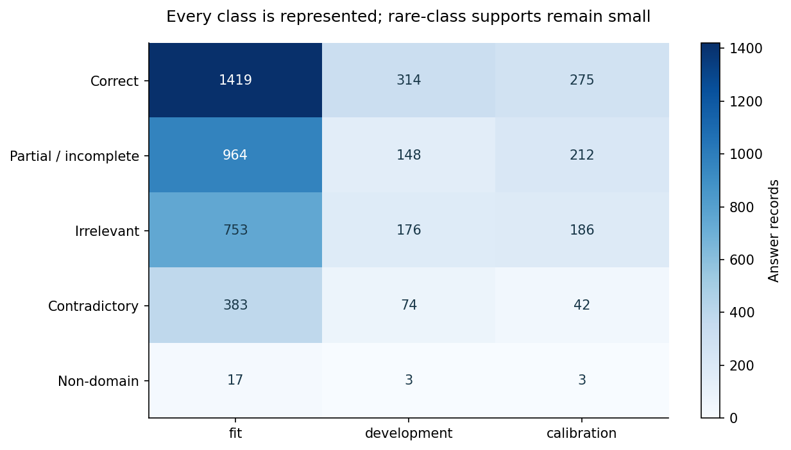
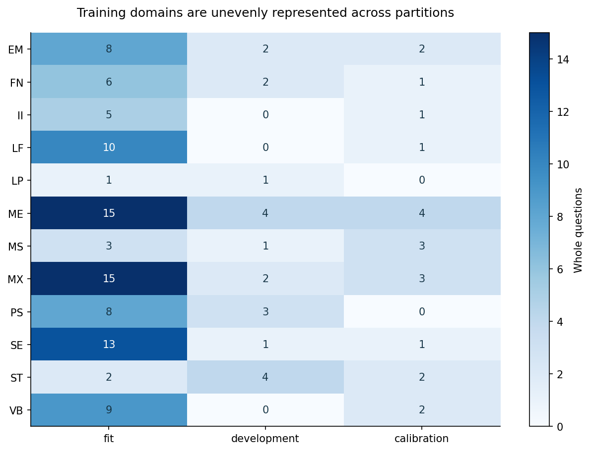

# Development split diagnostics

These figures describe a training-only allocation; they are not model results. The 135 official training questions are assigned as whole groups. [Protocol and policies](../../docs/split_design.md) · [Assignments](../../data/splits/v1/) · [Executed notebook](../../notebooks/02_split_design.ipynb).

## Partition sizes

Fit: 3,536 answers / 95 questions. Development: 715 / 20. Calibration: 718 / 20. The question proportions are approximately 70/15/15; the answer-record proportions are 71.16/14.39/14.45 because question sizes differ.

## Class support

All five classes occur in every partition. Non-domain support is only 17/3/3; no reliable class-specific calibration claim follows from this small coverage constraint.

## Domain support

Cells count whole questions, not answer records. Domain coverage varies: fit contains 12 codes, development 9, and calibration 10. Source domain codes are preserved.

## Leakage checks and data policy

All three partition pairs have zero shared sample IDs, question IDs, and normalized complete inputs. Original rows and labels are retained. Conflicts are flagged without relabelling. The main experiment uses unit weights; optional inverse-input-frequency fit weights are prepared for a later sensitivity analysis. Exact checks: [overlap_checks.csv](overlap_checks.csv). Class counts: [class_support.csv](class_support.csv).

No official evaluation CSV is read by the split builder. The final-fit and probability-calibration recipe must be specified before official UA/UQ/UD scoring; see the protocol's final-fit section for the distinction between the official UA label and the questions actually seen by a fitted model.

Data and data-derived outputs: CC BY-SA 3.0; Dzikovska et al. (2013), https://aclanthology.org/S13-2045/.
